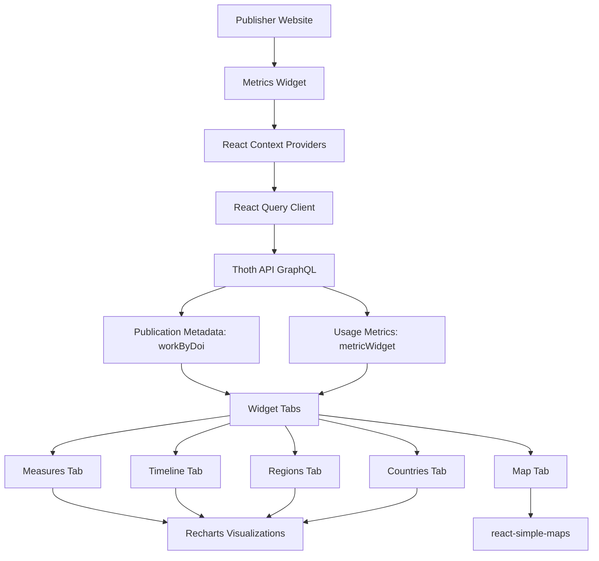

# Metrics Widget

A React-based widget for displaying publication metrics from multiple platforms. Designed for publishers to easily embed comprehensive usage statistics for their publications identified by DOI.

From 3.x the widget reads its usage data from the public [Thoth](https://thoth.pub) GraphQL API (`metricWidget`), the same API it uses for publication metadata. The 2.x line reads usage data from the OPERAS metrics API.

## Features

- 📊 **Multiple Visualization Tabs**: Measures, Timeline, Map, Regions, and Countries
- 🗺️ **Geographic Distribution**: Interactive world map showing global reach
- 📈 **Time-based Analytics**: Track metrics by year, and by month within a year
- 🎨 **Fully Customizable**: Override styles via CSS custom properties or a typed `theme` prop
- 📱 **Responsive Design**: Works seamlessly on mobile, tablet, and desktop
- 🔌 **Easy Integration**: Works with React or JavaScript projects

## Installation

### For React Projects

```bash
npm install metrics-widget
```

React 19 users may see a peer dependency warning from `react-simple-maps`, whose published peer range has not yet been updated for React 19. The widget is intended for React 19 and installs/builds with React 19 despite that upstream warning.

### For Vanilla JavaScript Projects

#### Option 1: NPM Install (with bundler)

```bash
npm install metrics-widget
```

#### Option 2: CDN (no bundler required)

```html
<!-- CSS -->
<link rel="stylesheet" href="https://unpkg.com/metrics-widget@3/dist/metrics-widget.css">

<!-- Import map for React dependencies -->
<script type="importmap">
  {
    "imports": {
      "react": "https://esm.sh/react@19",
      "react-dom": "https://esm.sh/react-dom@19",
      "react-dom/client": "https://esm.sh/react-dom@19/client",
      "react/jsx-runtime": "https://esm.sh/react@19/jsx-runtime"
    }
  }
</script>

<!-- Widget script -->
<script type="module">
  import { initMetricsWidget } from 'https://unpkg.com/metrics-widget@3/dist/metrics-widget.js';
  // Use widget here
</script>
```

> **Versions.** `@3` resolves to the 3.x line, which reads usage data from Thoth. `@2` keeps resolving to the 2.x line, which reads usage data from the OPERAS metrics API; embeds pinned to `@2` are not moved to 3.x.

## Quick Start

### React Implementation

```tsx
import { MetricsWidget } from 'metrics-widget';
import 'metrics-widget/styles.css';

function App() {
  return (
    <div>
      <h1>Publication Metrics</h1>
      <MetricsWidget doi="10.11647/OBP.0159" />
    </div>
  );
}

export default App;
```

### Vanilla JavaScript Implementation

#### With Bundler (Webpack, Vite, etc.)

```html
<!DOCTYPE html>
<html lang="en">
<head>
  <meta charset="UTF-8">
  <meta name="viewport" content="width=device-width, initial-scale=1.0">
  <title>Metrics Widget Demo</title>
</head>
<body>
  <div id="metrics-container"></div>
  
  <script type="module">
    import 'metrics-widget/styles.css';
    import { initMetricsWidget } from 'metrics-widget';
    
    // Initialize the widget
    const widget = initMetricsWidget('metrics-container', '10.11647/OBP.0159');
    
    // Cleanup when needed
    // widget.unmount();
  </script>
</body>
</html>
```

#### Without Bundler (CDN + Import Maps)

For environments without a build tool, use import maps to load React from CDN:

```html
<!DOCTYPE html>
<html lang="en">
<head>
  <meta charset="UTF-8">
  <meta name="viewport" content="width=device-width, initial-scale=1.0">
  <title>Metrics Widget Demo</title>
  
  <!-- Load the widget CSS -->
  <link rel="stylesheet" href="https://unpkg.com/metrics-widget@3/dist/metrics-widget.css">
  
  <!-- Import map for React dependencies from CDN -->
  <script type="importmap">
    {
      "imports": {
        "react": "https://esm.sh/react@19",
        "react-dom": "https://esm.sh/react-dom@19",
        "react-dom/client": "https://esm.sh/react-dom@19/client",
        "react/jsx-runtime": "https://esm.sh/react@19/jsx-runtime"
      }
    }
  </script>
</head>
<body>
  <h1>Publication Metrics</h1>
  <div id="app"></div>
  
  <!-- Initialize widget using ES modules -->
  <script type="module">
    import { initMetricsWidget } from 'https://unpkg.com/metrics-widget@3/dist/metrics-widget.js';
    
    // Initialize the widget
    const widget = initMetricsWidget('app', 'https://doi.org/10.11647/OBP.0159');
    
    console.log('Widget initialized:', widget);
    
    // Cleanup when needed
    // widget.unmount();
  </script>
</body>
</html>
```

**Note**: Import maps are supported in all modern browsers (Chrome 89+, Firefox 108+, Safari 16.4+, Edge 89+). For older browsers, use a bundler or polyfill.

## API Reference

### React Component

#### Props

```typescript
interface MetricsWidgetProps {
  doi: string;                      // DOI identifier (with or without https://doi.org/ prefix)
  theme?: MetricsWidgetTheme | null; // Optional runtime token overrides (see "Customization")
}
```

`MetricsWidgetTheme` is a typed `Partial<Record<MetricsWidgetTokenName, string>>` exported from the package; consumers get autocomplete for every `mw-*` token name and rejection of typos at compile time.

**Example DOI formats:**
- `"10.11647/OBP.0159"`
- `"https://doi.org/10.11647/OBP.0159"`

The component also self-wraps its required React Query / services / theming providers — render `<MetricsWidget>` directly without composing any extra context yourself.

### JavaScript API

#### `initMetricsWidget(containerId, doi, options?)`

Initializes the metrics widget in the specified container.

**Parameters:**
- `containerId` (string): The ID of the DOM element to render the widget in
- `doi` (string): The DOI identifier for the publication
- `options` (object, optional):
  - `theme?: MetricsWidgetTheme` — initial theme (same shape as the React `theme` prop)

**Returns:**
```typescript
interface MetricsWidgetInstance {
  unmount: () => void;                                       // remove the widget from the DOM
  setTheme: (theme: MetricsWidgetTheme | undefined) => void; // re-theme without remounting
}
```

**Example:**

```javascript
const widget = initMetricsWidget('app', '10.11647/OBP.0159', {
  theme: {
    'mw-color-background': '#1a1a1a',
    'mw-color-typography': '#f5f5f5',
  },
});

// Re-theme on the fly
widget.setTheme({ 'mw-color-background': '#fff' });

// Tear it down
widget.unmount();
```

## API Endpoints

The published widget connects to these default APIs:

- `VITE_THOTH_API_URL`: `https://api.thoth.pub/graphql` (publication metadata and usage metrics)

Both reads go to that one public GraphQL endpoint, without credentials or cookies: `workByDoi` for the publication and its chapters, and `metricWidget` for usage data. `VITE_METRICS_API_URL` was removed in 3.x, together with the OPERAS metrics API it pointed to.

Endpoint overrides are not currently exposed as part of the public package API. The `VITE_*` names are used only when building this repository from source.

## Customization

The widget exposes its design tokens as CSS custom properties — every visible color and layout dimension is namespaced under `--mw-*` so the bundle never collides with the host page. There are two ways to override them; pick whichever fits your stack.

### Host-page isolation at a glance

- **Token namespace.** Every overridable token is prefixed `--mw-*`; you can't accidentally clobber a host token of the same name.
- **Cascade layer.** Bundled styles live inside `@layer metrics-widget`, so any consumer rule outside any layer wins regardless of source order.

### 1. CSS variable overrides (preferred for static themes)

Drop a `:root` block into any stylesheet. The widget's CSS lives inside `@layer metrics-widget`, so anything you write outside a layer wins automatically — no source-order gymnastics required.

```css
:root {
  /* Backgrounds & typography */
  --mw-color-background: #fff9e6;
  --mw-color-background-alt: #fffbf0;
  --mw-color-typography: #1a1a1a;

  /* Accents */
  --mw-color-active: hsl(284, 36%, 59%);
  --mw-color-border: hsl(284, 26%, 41%);
  --mw-ring: hsl(276, 26%, 50%);

  /* Per-platform chart colors */
  --mw-chart-metric-google-books: #ff8800;
  --mw-chart-metric-twitter: #1da1f2;

  /* Countries/Regions pie palette (darkest → lightest) */
  --mw-color-countries-1: hsl(284, 54%, 14%);
  --mw-color-countries-2: hsl(284, 36%, 28%);
  --mw-color-countries-3: hsl(284, 26%, 41%);
  /* ...through --mw-color-countries-11 */
}
```

A platform takes its own `--mw-chart-metric-<slug>` token when one exists for its code or display name (slugged). A platform without its own token takes a colour from a fixed list, in platform order: `default`, `wikimedia`, `crossref`, `oapen`, `open-book-publishers`, `wordpress-com`, `twitter`, skipping a colour already used by a platform with its own token. Overriding one of those tokens therefore also changes the colour of any platform that falls back to it.

> **Caveat.** Cascade layers don't beat host `!important`. If another stylesheet already uses `!important` on the same token, your override will need `!important` too.

### 2. React `theme` prop / vanilla JS option (preferred for dynamic themes)

Pass a JS object to `<MetricsWidget>` or `initMetricsWidget`. Useful when the parent app drives theming from state — for example a "brand mode" toggle. The keys are the token names without the leading `--`, and the type is exported as `MetricsWidgetTheme` for autocomplete and typo-protection.

```tsx
import {
  MetricsWidget,
  type MetricsWidgetTheme,
} from 'metrics-widget';
import 'metrics-widget/styles.css';

const brandTheme: MetricsWidgetTheme = {
  'mw-color-background': '#1a1a1a',
  'mw-color-typography': '#f5f5f5',
  'mw-color-active': 'hsl(280, 50%, 60%)',
  'mw-chart-metric-google-books': '#ff8800',
};

export default function App() {
  return <MetricsWidget doi="10.11647/OBP.0067" theme={brandTheme} />;
}
```

Vanilla JS:

```js
import { initMetricsWidget } from 'metrics-widget';

const widget = initMetricsWidget('metrics-container', '10.11647/OBP.0067', {
  theme: {
    'mw-color-background': '#1a1a1a',
    'mw-color-typography': '#f5f5f5',
  },
});

// Re-theme without remounting
widget.setTheme({ 'mw-color-background': '#fff' });

// Tear it down
widget.unmount();
```

The CSS-variable path and the JS-prop path can be combined: pass a `theme` prop for runtime/state-driven values, and use a `:root` block for static brand defaults.

### Theme prop behavior

A few rules govern how the `theme` prop is applied at runtime:

- **Merge, not replace.** Each new `theme` object merges into the previously applied set. Keys you omit from a subsequent update **keep their previously applied values** — they are not auto-reverted. To clear a single key, pass `undefined` for it (`theme={{ 'mw-color-background': undefined }}`); to clear everything, unmount the widget.
- **Color values are validated.** Color tokens (everything except layout dimensions, `mw-radius`, `mw-tooltip-drop-shadow`, `mw-font-heading`, `mw-font-body` and `mw-heading-text-transform`) are validated before being applied. Accepted formats: named CSS colors (`red`, `rebeccapurple`), 3- or 6-digit hex (`#fff`, `#1a1a1a`), `rgb()` / `rgba()`, and `hsl()` / `hsla()`. Other formats — 4- or 8-digit hex (`#abcd`, `#1a1a1a80`), `oklch()`, `color()`, `lab()`, `lch()` — are not currently validated and will be rejected. Invalid values are silently dropped: the previously applied valid value (or bundle default) stays in place.
- **Non-color tokens are not validated.** Layout, radius, shadow, font, and heading-case tokens accept any string and are written through as-is.
- **Cleanup on unmount.** Every key the widget ever wrote via the prop is removed from `document.documentElement.style` when the widget unmounts, so no overrides leak back to the host.
- **Hidden until applied.** On first mount the widget keeps its root `visibility: hidden` until tokens have been written to `document.documentElement`. The reveal happens before the first paint, so consumers passing a synchronous `theme` never see a flash of bundle defaults.

### Async theme loading

The hide-until-applied gate releases on the **first commit** after mount. If your theme is fetched asynchronously (API, `localStorage`, `matchMedia`, …), mount the widget conditionally so its first commit already carries the resolved theme:

```tsx
const theme = useResolvedTheme(); // returns undefined until ready

return theme ? <MetricsWidget doi={doi} theme={theme} /> : null;
```

Mounting with `theme={undefined}` and updating to `theme={resolved}` later will release the gate on the first commit with bundle defaults, then repaint when your theme arrives.

### Matching a publisher site's style

To make the widget look like the site that hosts it, set a handful of tokens: fonts, heading case, background, text, accent, buttons, tabs and the platform colours. With no theme the widget looks exactly as before. Use either a CSS block or a `theme` object; both set the same tokens.

CSS block (in your site's stylesheet, outside any `@layer`):

```css
:root {
  /* Fonts and heading case */
  --mw-font-heading: "Lato", sans-serif;
  --mw-font-body: "Lato", sans-serif;
  --mw-heading-text-transform: none; /* default: uppercase */

  /* Background and text */
  --mw-color-background: #ffffff;
  --mw-color-background-alt: #f6f6f6;
  --mw-color-typography: #1b1b1b;

  /* Accent, tabs and buttons */
  --mw-color-active: #0b6b5d;
  --mw-color-border: #0b6b5d;
  --mw-ring: #0b6b5d;
  --mw-color-nav-background: #ffffff;
  --mw-color-nav-background-active: #0b6b5d;
  --mw-color-nav-typography: #0b6b5d;
  --mw-color-button-background: #ffffff;
  --mw-color-button-typography: #0b6b5d;
  --mw-color-button-border: #0b6b5d;
  --mw-color-button-active-background: #0b6b5d;
  --mw-color-button-active-typography: #ffffff;
  --mw-color-button-active-border: #0b6b5d;

  /* Platform colours, one per Thoth platform code */
  --mw-chart-metric-publisher-website: #e07a1f;
  --mw-chart-metric-oapen: #5fb0d3;
}
```

The same theme as a `theme` object:

```tsx
import { MetricsWidget, type MetricsWidgetTheme } from 'metrics-widget';

const siteTheme: MetricsWidgetTheme = {
  'mw-font-heading': '"Lato", sans-serif',
  'mw-font-body': '"Lato", sans-serif',
  'mw-heading-text-transform': 'none',
  'mw-color-background': '#ffffff',
  'mw-color-background-alt': '#f6f6f6',
  'mw-color-typography': '#1b1b1b',
  'mw-color-active': '#0b6b5d',
  'mw-color-border': '#0b6b5d',
  'mw-ring': '#0b6b5d',
  'mw-color-nav-background': '#ffffff',
  'mw-color-nav-background-active': '#0b6b5d',
  'mw-color-nav-typography': '#0b6b5d',
  'mw-color-button-background': '#ffffff',
  'mw-color-button-typography': '#0b6b5d',
  'mw-color-button-border': '#0b6b5d',
  'mw-color-button-active-background': '#0b6b5d',
  'mw-color-button-active-typography': '#ffffff',
  'mw-color-button-active-border': '#0b6b5d',
  'mw-chart-metric-publisher-website': '#e07a1f',
  'mw-chart-metric-oapen': '#5fb0d3',
};

<MetricsWidget doi="10.11647/OBP.0067" theme={siteTheme} />;
```

Things to know:

- **Fonts.** `--mw-font-heading` sets the font of the tab labels and other headings, and `--mw-font-body` the font of everything else, including chart labels. The widget bundles Economica and Open Sans, its defaults. If you name any other font, your site must load it (for example with `@font-face` or a `<link>` to your font provider); the widget does not download fonts for you. List a fallback, as in `"Lato", sans-serif`. The older names `--mw-font-economica` and `--mw-font-open-sans` still work and are what the new tokens use by default.
- **Heading case.** `--mw-heading-text-transform` takes any CSS `text-transform` value (`uppercase`, `none`, `capitalize`, `lowercase`). It applies to every heading that is uppercase by default.
- **Platform colours.** The token for a platform is `--mw-chart-metric-<slug>`, where the slug is the platform's Thoth `code` in lower case, with each run of characters other than letters and digits replaced by one hyphen. So the code `publisher_website` becomes `--mw-chart-metric-publisher-website`. The widget looks for the token of the code first, then for the one made the same way from the platform's display name. In the `theme` object, any key that starts with `mw-chart-metric-` is accepted, so you can colour any platform; a misspelt token name that does not start with `mw-chart-metric-` is a compile error. Which platform gets which colour when it has no token of its own is described under "CSS variable overrides" above.
- **One theme per page.** The `theme` prop writes to the page root (`document.documentElement`), so every widget on a page shares one theme. Do not mount two widgets with different themes.
- **Colour formats.** Colour tokens accept the formats listed under "Theme prop behavior" below. The font and heading-case tokens are not validated; their values are written as given.

### Token catalog

All overridable tokens, grouped by tier:

```text
# Semantic
--mw-color-background, --mw-color-background-active, --mw-color-background-alt
--mw-color-typography, --mw-color-typography-alt
--mw-color-border, --mw-color-active, --mw-ring

# Components
--mw-color-nav-background, --mw-color-nav-background-active, --mw-color-nav-typography
--mw-color-header-background
--mw-color-button-background, --mw-color-button-typography, --mw-color-button-border
--mw-color-button-typography-hover, --mw-color-button-border-hover
--mw-color-button-typography-active, --mw-color-button-border-active
--mw-color-button-active-background, --mw-color-button-active-typography, --mw-color-button-active-border
--mw-color-input-background, --mw-color-input-border, --mw-color-input-typography
--mw-color-select-background-selected, --mw-color-input-start-icon
--mw-color-tooltip-background, --mw-tooltip-drop-shadow
--mw-color-divider, --mw-color-spinner
--mw-chart-legend-background
--mw-color-placeholder-icon, --mw-color-placeholder-icon-bg

# shadcn-derived (ui primitives)
--mw-radius
--mw-background, --mw-foreground
--mw-popover, --mw-popover-foreground
--mw-primary, --mw-primary-foreground
--mw-secondary, --mw-secondary-foreground
--mw-muted, --mw-muted-foreground
--mw-destructive, --mw-border

# Fonts and heading case
--mw-font-heading, --mw-font-body, --mw-heading-text-transform

# Layout
--mw-max-width, --mw-max-height
--mw-header-height, --mw-footer-height, --mw-content-height

# Countries/Regions pie palette
--mw-color-countries-1 ... --mw-color-countries-11

# Per-platform chart palette
--mw-chart-metric-default
--mw-chart-metric-the-classics-library, --mw-chart-metric-google-books
--mw-chart-metric-open-book-publishers
--mw-chart-metric-open-book-publishers-html-reader
--mw-chart-metric-open-book-publishers-pdf-reader
--mw-chart-metric-open-edition, --mw-chart-metric-oapen
--mw-chart-metric-twitter, --mw-chart-metric-wikimedia, --mw-chart-metric-wikipedia
--mw-chart-metric-wordpress-com, --mw-chart-metric-world-reader
--mw-chart-metric-crossref
--mw-chart-metric-<slug>  (any other platform: the slug of its code)

# Map gradient
--mw-chart-map-zero, --mw-chart-map-lowest, --mw-chart-map-highest
```

## Widget Features

The widget provides five comprehensive tabs for analyzing publication metrics:

### 1. 📊 Measures Tab

Displays the total of each measure on each platform (for example "OAPEN · Downloads"), as Thoth reports it:
- **Book**: the work's own usage
- **Chapters**: the summed usage of its chapters (all chapters, or the ones selected)

Features:
- Select chapters
- Download data as CSV

### 2. 📈 Timeline Tab

Visualizes metrics over time:
- One point per year, from the first month Thoth has data for up to the current month
- Opening one year shows that year by month
- Filter the measures shown
- Year-based pagination for large datasets

Perfect for:
- Tracking growth trends
- Identifying seasonal patterns
- Comparing platform performance over time

The current month and other recent periods show the values collected so far; they may still grow as data arrives.

### Geography (Map, Regions and Countries tabs)

The three geography tabs share **one combined distribution**: for each country, the sum of its values over every platform and measure shown, for the book and its chapters together (or the selected chapters). There is no platform selector. Countries are identified by ISO 3166-1 code.

- **Shares** are each country's (or region's) value over the sum of all country values. If any value is negative or the sum is 0, no shares are drawn: the tab says "Shares cannot be shown", and the CSV gives the values with the share `n/a`.
- **No country breakdown.** A platform and measure that has usage but no country values in the book or in the chapters is named under the chart, for example `No country breakdown for: OAPEN · Downloads (book), Zenodo · Views (chapters).` Its usage is not part of the distribution.
- When there are no country values at all, the tabs say "There are no country values for this work." (never 0%).

### 3. 🗺️ Map Tab

World map coloured by each country's share of the distribution:
- Hover shows `<Country> · <share>%`, or `<Country> · no data` for a country without a value
- CSV download (`Country, Value, Percentage`, every country)

### 4. 🌍 Regions Tab

Regional breakdown, using the UN M49 regions:
- Africa, Asia, Europe, Latin America and the Caribbean, Northern America, Oceania and Antarctica; a code outside the table goes to "Other or unknown region"
- Pie chart, with each region's value in its tooltip, and a list with each region's share
- CSV download (`Region, Value, Percentage`)

### 5. 🌐 Countries Tab

The top countries of the distribution:
- The top 10 countries, then "Others" for the rest
- Pie chart, with each country's value in its tooltip, and a list with each country's share
- CSV download (`Country, Value, Percentage`, every country)

## Architecture



### Data Flow

1. **Initialization**: Widget receives DOI prop
2. **Validation**: DOI is validated using `doi-utils` library
3. **Metadata Fetch**: Publication metadata and its chapters retrieved from the Thoth API (`workByDoi`)
4. **Metrics Fetch**: One `metricWidget` read from the Thoth API per year view (book and chapter totals, yearly timeline, countries), and one more for each year opened by month
5. **Processing**: Values are kept exactly as Thoth returns them; a missing value is shown as unknown, never as 0
6. **Visualization**: Charts and maps render the processed data


## Tracked Platforms

The platforms and measures shown are the ones Thoth serves for the work: their names, definitions and descriptions come from the `metricWidget` response, and the info panel of each tab lists the ones shown. Which platforms are available depends on the data each publisher has in Thoth.

## Development

### Prerequisites

- Node.js 18+ and npm
- React 19+ (peer dependency)

### Setup

```bash
# Clone the repository
git clone https://github.com/thoth-pub/metrics-widget.git
cd metrics-widget

# Install dependencies
npm install

# Create environment file
cp .env.example .env

# Start development server
npm run dev
```

### Build

```bash
# Production build
npm run build

# Preview build
npm run preview
```
